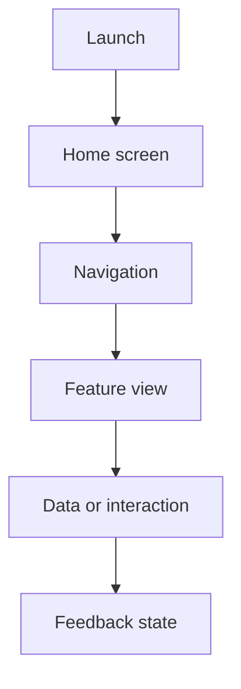

# Mobile Application Development

  

A Kotlin-based learning project for building mobile interfaces, navigation flows, and practical Android application features.

## App flow

## Getting started

Open the project in Android Studio, let Gradle sync, select an emulator or device, and run the app configuration.

## Quality checklist

Test different screen sizes, handle loading and empty states, preserve accessibility labels, and keep secrets outside the repository.
